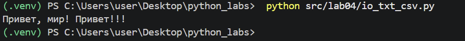
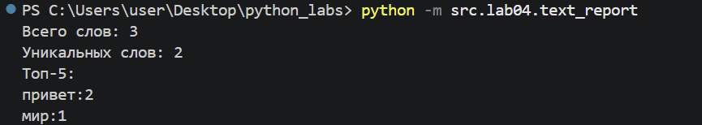
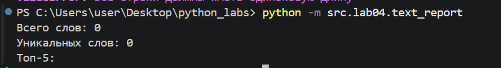
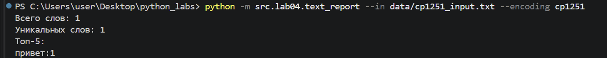

# ЛР4 — Файлы: TXT/CSV и отчёты по текстовой статистике
---
## Задание A
### 1.read_text()
```python
def read_text(path: str | Path, encoding: str = "utf-8") -> str:
    """
    Читает текстовый файл целиком и возвращает его содержимое одной строкой.

    По умолчанию используется кодировка UTF-8.
    Для другой кодировки можно передать её явно, например:
    encoding="cp1251".

    Если файл не существует, всплывает FileNotFoundError.
    Если кодировка не подходит, всплывает UnicodeDecodeError.
    """
    p = Path(path)
    return p.read_text(encoding=encoding)
```
Функция читает текстовый файл. По умолчанию стоит кодировка utf-8. Внутри функции создается объект Path из переданного пути. Если файл не найден или кодировка не подходит -  FileNotFoundError / UnicodeDecodeError. Возвращает содержимое в виде одной строки. 
### 2.ensure_parent_dir()
```python
def ensure_parent_dir(path: str | Path):
    """
    Создаёт родительские директории для указанного пути,
    если они ещё не существуют.
    """
    p = Path(path)
    p.parent.mkdir(parents=True, exist_ok=True)
```
Функция принимает на вход либо строку, либо объект(Path).".mkdir" создает папки ("make directory").
parents=True - если родительской папки нет, то создает ее, exist_ok=True -  если папка существует не вызывать ошибку. Функция ничего не возвращает, она создает папки.
### 3.write_csv()
```python

def write_csv(rows: Iterable[Sequence], path: str | Path, header: tuple[str, ...] | None = None) -> None:
    p = Path(path)
    rows = list(rows)
    if len(rows)>0:
        l1=len(rows[0])
        for row in rows:
            if len(row)!=len(rows):
                raise ValueError("Все строки должны иметь одиноковую длину")
        if header is not None and len(header)!=l1:
            raise ValueError("Длина заголовка должна совпадать с длиной строк")
    ensure_parent_dir(path)
    with p.open("w", newline="", encoding="utf-8") as f:
        w = csv.writer(f)
        if header is not None:
            w.writerow(header)
        for r in rows:
            w.writerow(r)
```

Функция принимает на вход путь к файлу в виде строки или объекта Path. Далее переводит объект в список. Затем проверяет все ли строки одной длины(в том числе загаловок), если нет то выводит ошибку. Открывет файл с помощью p.open. Испоьзует csv.writer(), записывает заголовок , после в цикле записывает в файл каждую строку.

Мини-тесты:
```python
if __name__ == "__main__":
    txt = read_text("data/lab04/input.txt")
    print(txt)
    write_csv([("word","count"),("test",3)], "data/lab04/check.csv")
```


---
## Задание В
```python
import sys

from src.lib.text import normalize, tokenize, count_freq, top_n
from src.lab04.io_txt_csv import read_text, write_csv
input_text="data/lab04/input.txt"

def sorted_words(freq):
    return sorted(freq.items(),key=lambda x: (-x[1],x[0]))

def main():
    try:
        text = read_text(input_text, encoding="utf-8")
    except FileNotFoundError:
        print("файл не найден")
        sys.exit(1)
        
    normal=normalize(text)
    token=tokenize(normal)
    freq=count_freq(token)
    top=top_n(freq,5)
    write_csv(sorted_words(freq),"data/lab04/report.csv", header=("word", "count"))

    print(f'Всего слов: {len(token)}')
    print(f'Уникальных слов: {len(freq)}')
    print("Топ-5:")
    for w,c in top:
        print(f'{w}:{c}')
if __name__ == "__main__":
    main()
```
Функция пробует прочитать файл, если его нет, выводит ошибку, избегая падения. Текст обрабатыватся с помощью функций из лабы 3. Масив, отсортированный по убыванию частоты и по алфавиту при равенстве, сохраняется в CSV с колонками word,count. В консоль выводится общее количество слов, количество уникальных слов и топ-5 самых частых слов.

## Краевые ошибки и тесты
### Тест А(Один файл)

### Тест В(Пустой файл)

Пустой файл-empty.csv содержит только заголовок.
При передаче пустого файла в консоль выводятся нули.
### Текст С(Файл ср1251)

Другая кодировка выбирается параметром encoding. В файле text_report заменить, например: text = read_text(input_text, encoding="cp1251")
### Файл не найден
Программа выдаст: Ошибка: файл не найден: <сам файл>. И завершит работу.


