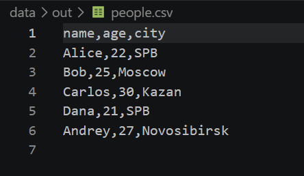
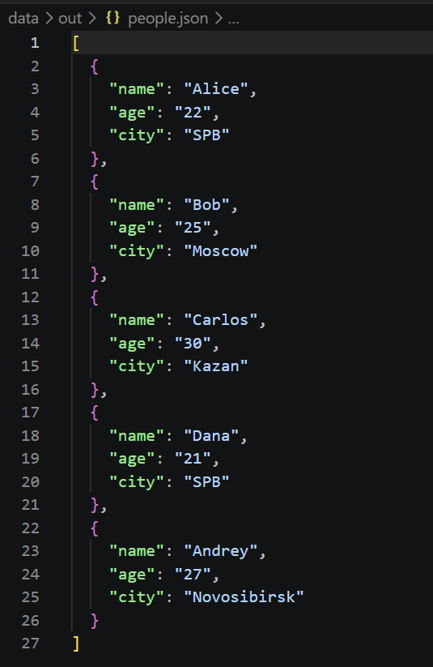
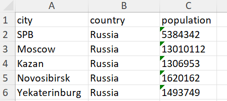
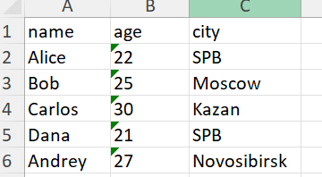

# ЛР5 - JSON и конвертации (JSON↔CSV, CSV→XLSX)
---
## Задание A — JSON ↔ CSV
### json_to_csv
```python
def json_to_csv(json_path: str, csv_path: str) -> None:
    """
    Преобразует JSON-файл в CSV.
    Поддерживает список словарей [{...}, {...}], заполняет отсутствующие поля пустыми строками.
    Кодировка UTF-8. Порядок колонок — как в первом объекте или алфавитный (указать в README).
    """
    jp=Path(json_path)
    cp=Path(csv_path)
    
    if not jp.is_file():
        raise FileNotFoundError(f"Файл не найден: {json_path}")
    if jp.suffix.lower() != ".json":
        raise ValueError("Входной файл должен иметь расширение .json")

    if cp.suffix.lower() != ".csv":
        raise ValueError("Выходной файл должен иметь расширение .csv")

    with jp.open('r',encoding='utf-8') as f:
        try:
            data=json.load(f)
        except json.JSONDecodeError:
            raise ValueError("Неверный формат JSON или файл пуст")

    if type(data)!=list or len(data)==0:
        raise ValueError("Пустой JSON или неподдерживаемая структура")
    for item in data:
        if type(item)!=dict:
            raise ValueError("JSON должен содержать список словарей")

    columns=[]
    for item in data:
        for key in item:
            if key not in columns:
                columns.append(key)
    
    if not columns:
        raise ValueError("В JSON отсутствуют поля для CSV")
    
    with cp.open('w',newline="",encoding='utf-8') as f:
        w=csv.DictWriter(f,fieldnames=columns)
        w.writeheader()
        w.writerows(data)
```
Функция:

1. Проверяет расширение файлов и существование одного из них.
2. Считывает данные с помощью json.load() и проверяет,что объект является непустым списком словарей.
3. Формирует список столбцов из всех ключей в порядке их первого появления.
4. Записывает заголовок и строки в CSV.

---
### csv_to_json
```python

def csv_to_json(csv_path: str, json_path: str) -> None:
    jp=Path(json_path)
    cp=Path(csv_path)
    
    if not cp.is_file():
        raise FileNotFoundError(f"Файл не найден: {csv_path}")
    if cp.suffix.lower() != ".csv":
        raise ValueError("Входной файл должен иметь расширение .csv")

    if jp.suffix.lower() != ".json":
        raise ValueError("Выходной файл должен иметь расширение .json")
    with cp.open("r", newline="", encoding="utf-8") as f:
        reader = csv.DictReader(f)
        if reader.fieldnames is None:
            raise ValueError("Файл CSV пустой")
        data = list(reader)
    if len(data)==0:
        raise ValueError('CSV-файл не содержит данных')
    with jp.open("w", encoding="utf-8") as f:
        json.dump(data, f, ensure_ascii=False, indent=2)
```
---
Функция:
1. Проверяет расширение файлов и существование одного из них.
2. С помощью csv.DictResder(f) первая строка становится ключами(заголовками), остальные строки - словарями.
3. Проверяет наличие содержимого в файле.
4. Полученный список словарей сохраняется с помощью json.dump() с отступом в два пробела.
---
### Запуск
```python
if __name__ == '__main__':
    json_to_csv("data/samples/people.json", "data/out/people.csv")
    csv_to_json("data/samples/people.csv", "data/out/people.json")
```
Из корня репозитория:
```python
python -m src.lab05.json_csv
```
---
## Задание B — CSV → XLSX
```python
def csv_to_xlsx(csv_path: str, xlsx_path: str) -> None:
    """
    Конвертирует CSV в XLSX.
    Использовать openpyxl ИЛИ xlsxwriter.
    Первая строка CSV — заголовок.
    Лист называется "Sheet1".
    Колонки — автоширина по длине текста (не менее 8 символов).
    """
    cp=Path(csv_path)
    xlp=Path(xlsx_path)
    
    if not cp.is_file():
        raise FileNotFoundError("Файл не найден")
    if cp.suffix.lower() != ".csv":
        raise ValueError("Входной файл должен быть CSV")

    rows=[]
    with open(cp, encoding="utf-8", newline="") as f:
        for row in csv.reader(f):
            if row:
                rows.append(row)
    
    if len(rows) < 2:
        raise ValueError("CSV пустой или в нём нет данных (только заголовок)")

    wb = Workbook()
    ws = wb.active
    ws.title = "Sheet1"
    for row in rows:
        ws.append(row)
    wid = {}
    for row in rows:
        for i, value in enumerate(row, start=1):
            wid[i] = max(wid.get(i,0), len(value))
    for index, width in wid.items():
        letter = get_column_letter(index)
        ws.column_dimensions[letter].width = max(8, width)


    wb.save(xlsx_path)
```
Функция:
1. Проверяет расширение и существование файла.
2. Читает строки в кодировке UTF-8
3. Создает книгу Excel с помощью openpyxl и добавляет строки CSV в лист Sheet1 с помощью ws.append().
4. Ищет самый длинный текст в колонке и устанавливет ширину столбцов по максимальной длине содержимого.
5. Сохраняет результат по указанному пути.
---
### Запуск
```python
if __name__ == "__main__":
    csv_to_xlsx("data/samples/people.csv", "data/out/people.xlsx")
    csv_to_xlsx("data/samples/cities.csv", "data/out/cities.xlsx")
```
Из корня репозитория:
```python
python -m src.lab05.csv_xlsx
```
---
## Тесты
### 1.JSON -> CSV

### 2.CSV -> JSON

### 3.CSV → XLSX



