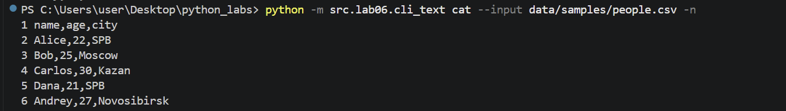
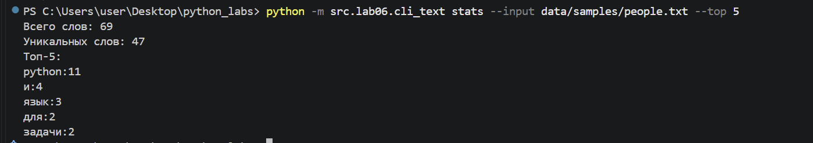
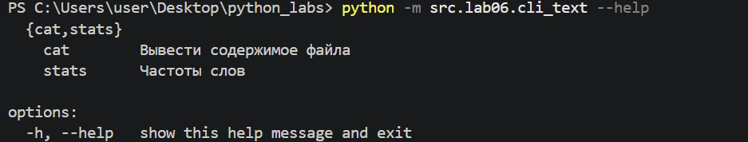
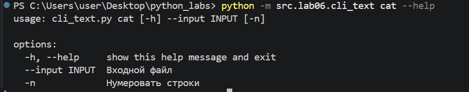
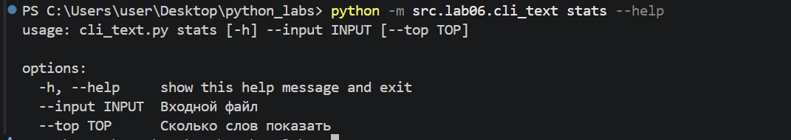
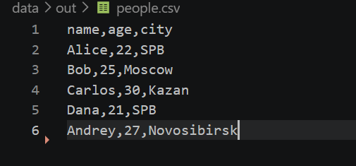
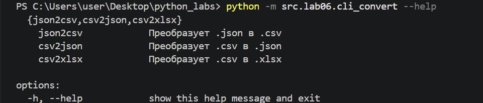
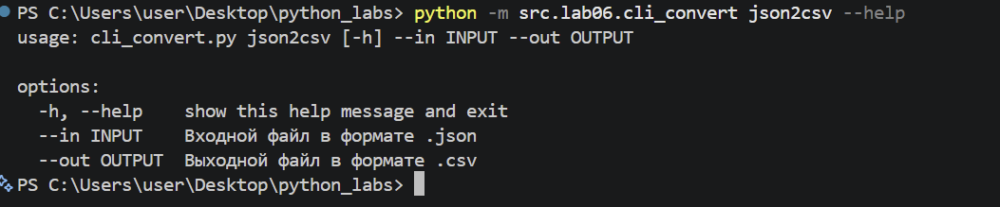

# ЛР6 — CLI‑утилиты с argparse (cat/grep‑lite + конвертеры)
## cli_text
### stats()
```python
def stats(input_path: str, top: int) -> None:
    path = Path(input_path)

    if not path.is_file():
        raise FileNotFoundError("File not found")

    with path.open("r", encoding="utf-8") as file:
        text = file.read()
    token=tokenize(normalize(text))
    freq=count_freq(token)
    print(f"Всего слов: {len(token)}")
    print(f"Уникальных слов: {len(freq)}")
    print(f"Топ-{top}:")
    for word, count in top_n(freq, top):
        print(f"{word}:{count}")
```
Функция читает содержимое файла в utf-8. Затем нормализует текст, подсчитывает частоты слов и выбирает наиболее частые слова. Выводит количество слов и топ самых частых слов.
### cat()
```python
def cat(input_path: str, numbered: bool = False) -> None:
    path = Path(input_path)

    if not path.is_file():
        raise FileNotFoundError("File not found")

    with path.open("r", encoding="utf-8") as file:
        for number, line in enumerate(file, start = 1):
            if numbered:
                print(f"{number} {line}", end="")
            else:
                print(line, end="")
```
Фунцкия с помощью Path проверяет существование входного файла. Далее файл открывается в кодировке UTF-8, а его содержимое выводится построчно.
### main()
```python

def main() -> None:
    
    parser = argparse.ArgumentParser(description="CLI‑утилиты")
    subparsers = parser.add_subparsers(dest="command")

    cat_parser = subparsers.add_parser("cat", help="Вывести содержимое файла")
    cat_parser.add_argument("--input", required=True,help="Входной файл")
    cat_parser.add_argument("-n", action="store_true", help="Нумеровать строки")


    stats_parser = subparsers.add_parser("stats", help="Частоты слов")
    stats_parser.add_argument("--input", required=True, help="Входной файл")
    stats_parser.add_argument("--top", type=int, default=5, help="Сколько слов показать")

    args = parser.parse_args()

    if args.command == "stats" and args.top < 1:
        parser.error("--top должен быть положительным числом")


    try:
        if args.command == "cat":
            cat(args.input, args.n)
        
        elif args.command == "stats":
            stats(args.input, args.top)
    except FileNotFoundError:
        parser.error(f"файл не найден: {args.input}")
    except UnicodeDecodeError:
        parser.error(f"файл {args.input} не читается в кодировке UTF-8")
```
Фунцкия вызывает в зависимости от команды функции cat и starts. 
---
### Тесты
1.
```python
python -m src.lab06.cli_text cat --input data/samples/people.csv -n
```

2.
```python
python -m src.lab06.cli_text stats --input data/samples/people.txt --top 5
```

---
### Проверки
1.
```python
python -m src.lab06.cli_text --help
```

2.
```python
python -m src.lab6.cli_text cat --help
```

3.
```python
python -m src.lab6.cli_text stats --help
```

---
## cli_convert
```python
import argparse
from src.lab05.json_csv import json_to_csv, csv_to_json
from src.lab05.csv_xlsx import csv_to_xlsx

def main() -> None:
    
    parser = argparse.ArgumentParser(description="Конвертеры данных")
    sub = parser.add_subparsers(dest="command")

    p1 = sub.add_parser("json2csv", help='Преобразует .json в .csv')
    p1.add_argument("--in", dest="input", required=True, help='Входной файл в формате .json')
    p1.add_argument("--out", dest="output", required=True, help='Выходной файл в формате .csv')

    p2 = sub.add_parser("csv2json", help='Преобразует .csv в .json')
    p2.add_argument("--in", dest="input", required=True, help='Входной файл в формате .csv')
    p2.add_argument("--out", dest="output", required=True, help='Выходной файл в формате .json')

    p3 = sub.add_parser("csv2xlsx", help='Преобразует .csv в .xlsx')
    p3.add_argument("--in", dest="input", required=True, help='Входной файл в формате .csv')
    p3.add_argument("--out", dest="output", required=True, help='Выходной файл в формате .xlsx')

    args = parser.parse_args()

    try:
        if args.command == "json2csv":
            json_to_csv(args.input, args.output)
        elif args.command == "csv2json":
            csv_to_json(args.input, args.output)
        elif args.command == "csv2xlsx":
            csv_to_xlsx(args.input, args.output)
    except FileNotFoundError:
        parser.error(f"файл не найден: {args.input}")
    except ValueError as error:
        parser.error(str(error))
        

if __name__ == '__main__':
    main()

```
Фунцкия с помощью argparse определяет три подкоманды (json2csv, csv2json и csv2xlsx). Каждая принимает два параметра:--in(входной файл) и --out(выходной файл). Затем в зависимости от команды программа вызывает функции из ЛР5.
---
### Тесты
1.
```python
python -m src.lab06.cli_convert json2csv --in data/samples/people.json --out data/out/people.csv
```

2.
```python
python -m src.lab06.cli_convert csv2json --in data/samples/people.csv --out data/out/people_new.json
```

3.
```python
python -m src.lab06.cli_convert csv2xlsx --in data/samples/people.csv --out data/out/people.xlsx
```

---
### Проверки
1.
```python
python -m src.lab06.cli_convert --help
```

2.
```python
python -m src.lab6.cli_convert json2csv --help
```

 


        


