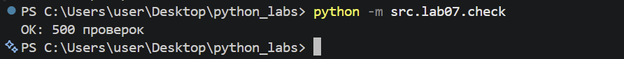

# ЛР7 - Поиск, сортировка и измерение времени
## search()
### linear_search()
Функция  перебирает элементы списка, сравнивает их с заданным числом. Возвращает индекс первого вхождения или -1, если число не найдено. Сложность: O(n)
``` python
def linear_search(nums, x):
    """Индекс первого вхождения x или -1.
 
    linear_search([4, 2, 7, 2], 2) -> 1
    linear_search([4, 2, 7, 2], 9) -> -1
    linear_search([], 1) -> -1
    """
    for i in range(len(nums)):
        if nums[i]==x:
            return i
    return -1
```
### binary_search()
Функция ищет число в отсортированном списке. Держит середину mid и сравнивает элемент с искомым. В соответсвтии с этим двигает границу lo или hi. Возвращает индекс элемента или -1. Сложность: O(log n)
``` python
def binary_search(sorted_nums, x):
    """Индекс x в отсортированном по возрастанию списке или -1.
    На неотсортированном списке результат не определён.
 
    binary_search([1, 3, 5, 7], 5) -> 2
    binary_search([1, 3, 5, 7], 4) -> -1
    binary_search([5], 5) -> 0
    binary_search([], 5) -> -1
    """
    lo=0
    hi=len(sorted_nums)-1
    while lo<=hi:
        mid=(lo+hi)//2
        if sorted_nums[mid]==x:
            return mid
        elif sorted_nums[mid]>x:
            hi=mid-1
        else:
            lo=mid+1
    return -1
```
### two_sum_brute()
Функция ищет пару чисел с заданной суммой при помощи двух вложенных циклов. Возвращает индексы элементов или None. Сложность: O(n^2)
``` python
def two_sum_brute(nums, target):
    """Пара индексов (i, j), i < j, nums[i] + nums[j] == target, или None.
 
    two_sum_brute([2, 7, 11, 15], 9) -> (0, 1)
    two_sum_brute([1, 2], 10) -> None
    """
    for i in range(len(nums)):
        for j in range(i+1,len(nums)):
            if nums[i]+nums[j]==target:
                return (i,j)
    return None
```
### two_sum_fast()
Функция ищет пару чисел с заданной суммой за один проход, сохраняя числа и индексы в словарь. Возвращает индексы элементов  или None. Сложность: O(n)
``` python
def two_sum_fast(nums, target):
    """То же, что two_sum_brute, но за один проход со словарём."""
    seen={}
    for i,x in enumerate(nums):
        need=target-x
        if need in seen:
            return (seen[need],i)
        seen[x]=i
    return None
```
## sorting()
### bubble_sort()
Функция за каждый проход идём по соседним парам и меняет их местами, если они стоят не по порядку. Флаг swapped останавливает цикл, когда за целый проход не было ни одного обмена, значит список уже упорядочен и менять уже не надо.
``` python
def bubble_sort(nums):
    """Новый список, отсортированный по возрастанию. Исходный не меняется.
 
    bubble_sort([3, 1, 2]) -> [1, 2, 3]
    bubble_sort([2, 2, 1]) -> [1, 2, 2]
    bubble_sort([]) -> []
    """
    nums=list(nums)
    n=len(nums)
    for i in range(n-1):
        swapped=False
        for j in range(n-i-1):
            if nums[j]>nums[j+1]:
                nums[j],nums[j+1]=nums[j+1],nums[j]
                swapped=True
        if not swapped:
            break
    return nums
```
### insertion_sort()
Функция берёт крайний в неотсортированной части элемент  и двигает его влево, пока слева стоят большие элементы, — после этого он встаёт на своё место.
``` python
def insertion_sort(nums):
    """Тот же контракт, что у bubble_sort."""
    nums=list(nums)
    for i in range(1,len(nums)):
        key=nums[i]
        j=i-1
        while j>=0 and nums[j]>key:
            nums[j+1]=nums[j]
            j-=1
        nums[j+1]=key
    return nums
```
### selection_sort()
Функция на каждом шаге в ещё не отсортированной части  находит индекс минимального элемента и ставит его на текущую позицию.
``` python
def selection_sort(nums):
    """Тот же контракт, что у bubble_sort."""
    nums=list(nums)
    for i in range(len(nums)-1):
        mn=i
        for j in range(i+1,len(nums)):
            if nums[j]<nums[mn]:
                mn=j
        nums[i],nums[mn]=nums[mn],nums[i]
    return nums

```
## check()
### check_sorting()
 Функция создает 100 случайных списков разной длины. Каждый результат сверяется с sorted(nums) и проверяется, что исходный список не изменился. При расхождении поднимается AssertionError.
``` python
def check_sorting(fn, trials=100):
    for _ in range(trials):
        n = random.randint(0, 50)
        nums = [random.randint(-100, 100) for _ in range(n)]
        original = list(nums)
        result = fn(nums)
        assert result == sorted(nums), f"{fn.__name__} ошиблась на {nums}: {result}"
        assert nums == original, f"{fn.__name__} изменила исходный список"
    return trials
```
### check_search()
Функция проверяет линейный и бинарный поиски на случайных списках, сравнивая результат с ожидаемым. При расхождении поднимается AssertionError.
``` python
def check_search():
    """
    Проверяет функции linear_search и binary_search на случайных данных.
    Возвращает количество успешно пройденных испытаний.
    """
    trials = 100
    for _ in range(trials):
        n = random.randint(0, 50)
        nums = [random.randint(-50, 50) for _ in range(n)]
        x = random.randint(-60, 60)
        
        # Линейный поиск против list.index
        try:
            expected_lin = nums.index(x)
        except ValueError:
            expected_lin = -1
        actual_lin = linear_search(nums, x)
        assert actual_lin == expected_lin, f"linear_search ошиблась для поиска {x} в {nums}: получено {actual_lin}, ожидалось {expected_lin}"

        # Бинарный поиск
        sorted_nums = sorted(nums)
        try:
            expected_bin = sorted_nums.index(x)
        except ValueError:
            expected_bin = -1
        actual_bin = binary_search(sorted_nums, x)
        if expected_bin == -1:
            assert actual_bin == -1, f"binary_search не нашла элемент, которого нет: {x} в {sorted_nums}"
        else:
            assert actual_bin != -1 and sorted_nums[actual_bin] == x, f"binary_search вернула некорректный индекс {actual_bin} для {x} в {sorted_nums}"
    return trials
```
### check_two_sum()
Функция проверяет two_sum поиски на случайных списках, сравнивая результат с ожидаемым. При расхождении поднимается AssertionError.
``` python
def check_two_sum(trials=100):
    """Оба two_sum дают пару с нужной суммой или оба None."""
    for _ in range(trials):
        n = random.randint(0, 30)
        nums = [random.randint(-30, 30) for _ in range(n)]
        target = random.randint(-60, 60)

        a = two_sum_brute(nums, target)
        b = two_sum_fast(nums, target)

        if a is None:
            assert b is None, f"Перебор не нашёл, словарь нашёл {b}"
            continue

        assert b is not None, f"Перебор нашёл {a}, словарь не нашёл"

        i, j = a
        assert nums[i] + nums[j] == target, f"brute вернул неверные индексы: {a}"
        i, j = b
        assert nums[i] + nums[j] == target, f"fast вернул неверные индексы: {b}"

    return trials
```
### main()
```python
if __name__ == "__main__":
    random.seed(42)
    total = 0
    for fn in (bubble_sort, insertion_sort, selection_sort):
        total += check_sorting(fn)
    total += check_search()
    total += check_two_sum()
    print(f"OK: {total} проверок")
```
## brench()
``` python 
import os
import random
import timeit

from src.lab04.io_txt_csv import write_csv
from src.lab07.sorting import bubble_sort, insertion_sort, selection_sort
from src.lab07.search import linear_search, binary_search, two_sum_brute, two_sum_fast

OUT_PATH = "data/lab07/bench.csv"


def make_numbers(n):
    """Создаёт список из n случайных чисел."""
    return [random.randint(-1_000_000, 1_000_000) for _ in range(n)]


def measure(fn, number=1):
    """Измеряет среднее время выполнения функции."""
    return timeit.timeit(fn, number=number) / number


def bench_sorts():
    """Сравнивает три сортировки со sorted."""
    rows = []

    algorithms = [
        ("sorted", sorted),
        ("bubble_sort", bubble_sort),
        ("insertion_sort", insertion_sort),
        ("selection_sort", selection_sort),
    ]

    for n in (1_000, 10_000, 100_000):
        data = make_numbers(n)

        for name, fn in algorithms:
            if n > 10_000 and name != "sorted":
                seconds = "> 60 с (не запускалось)"
            else:
                seconds = f"{measure(lambda: fn(data)):.6f}"

            rows.append(("sort", n, name, seconds))

    return rows


def bench_search():
    """Сравнивает линейный и бинарный поиск."""
    data = make_numbers(100_000)
    queries = [random.choice(data) for _ in range(10_000)]

    rows = []

    # Линейный поиск
    def run_linear():
        for x in queries:
            linear_search(data, x)

    linear_time = measure(run_linear)
    rows.append(("search", 100_000, "linear_search", f"{linear_time:.6f}"))

    # Предварительная сортировка (нужна бинарному поиску)
    sort_time = measure(lambda: sorted(data), 10)
    sorted_data = sorted(data)
    rows.append(("search", 100_000, "sort_before_binary", f"{sort_time:.6f}"))

    # Бинарный поиск
    def run_binary():
        for x in queries:
            binary_search(sorted_data, x)

    binary_time = measure(run_binary)
    rows.append(("search", 100_000, "binary_search", f"{binary_time:.6f}"))

    # Сортировка плюс бинарный поиск
    rows.append(("search", 100_000, "binary+sort", f"{sort_time + binary_time:.6f}"))

    return rows


def bench_two_sum():
    """Сравнивает два решения задачи Two Sum."""
    rows = []

    for n in (1_000, 10_000):
        # Большой разброс значений: суммы почти не повторяются, поэтому
        # нужная пара единственная и стоит в конце списка (худший случай перебора).
        nums = [random.randint(0, 10**12) for _ in range(n)]
        target = nums[-2] + nums[-1]

        # Перебор пар
        brute_time = measure(lambda: two_sum_brute(nums, target))
        rows.append(("two_sum", n, "two_sum_brute", f"{brute_time:.6f}"))

        # Решение через словарь (быстрое: запускаем 100 раз и усредняем)
        fast_time = measure(lambda: two_sum_fast(nums, target), 100)
        rows.append(("two_sum", n, "two_sum_fast", f"{fast_time:.6f}"))

    return rows


def print_table(rows):
    """Выводит результаты в виде таблицы."""
    print(f"{'task':<10} | {'n':>8} | {'impl':<22} | {'seconds':>25}")
    print("-" * 75)

    last = None

    for task, n, impl, seconds in rows:
        if last is not None and (task, n) != last:
            print()

        print(f"{task:<10} | {n:>8} | {impl:<22} | {seconds:>25}")
        last = (task, n)


def main():
    random.seed(42)

    rows = []
    rows += bench_sorts()
    rows += bench_search()
    rows += bench_two_sum()

    print("\nРЕЗУЛЬТАТЫ БЕНЧМАРКА")
    print_table(rows)

    # Создаём папку, если её нет, и сохраняем результаты в CSV
    os.makedirs("data/lab07", exist_ok=True)
    write_csv(rows, OUT_PATH, header=("task", "n", "impl", "seconds"))

    print(f"\nРезультаты сохранены в {OUT_PATH}")


if __name__ == "__main__":
    main()
```
1. make_numbers(n) — создаёт список из n случайных целых чисел в диапазоне от −1 000 000 до 1 000 000. Используется для подготовки данных для тестирования алгоритмов.

2. measure(fn, number=1) — измеряет время выполнения переданной функции с помощью timeit. Возвращает среднее время выполнения в секундах.

3. bench_sorts() — сравнивает скорость работы встроенной сортировки sorted() и трёх алгоритмов: пузырьковой, сортировки вставками и сортировки выбором. Проверяет их на списках разного размера.

4. bench_search() — сравнивает линейный и бинарный поиск на списке из 100 000 элементов. Также измеряет время предварительной сортировки данных для бинарного поиска.

5. bench_two_sum() — сравнивает два способа решения задачи Two Sum: полный перебор пар и использование словаря. Проверяет скорость обоих алгоритмов на списках разного размера.

6. print_table(rows) — выводит результаты измерений в консоль в виде таблицы. Показывает название задачи, размер списка, алгоритм и время выполнения.

7. main() — главная функция программы, которая запускает все тесты, собирает результаты и выводит их на экран. Затем сохраняет полученные данные в CSV-файл bench.csv.

## Выввод
### Результат работы check.py

### Результат бенчмарка

