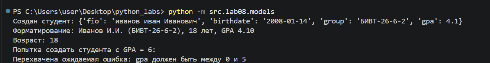
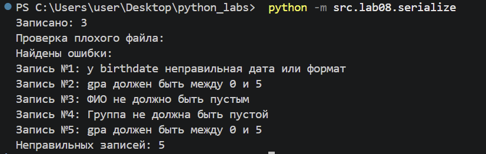
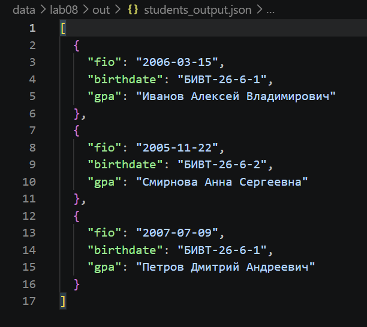

 # ЛР8 - Модель данных без классов: запись Student как словарь, валидация и сериализация
 ## Задание A - models.py
 ### make_student
 Функция проверяет типы данных, существующую дату рождения, gpa между 0 и 5. Создает словарь, беря эти данные за ключи.
 ``` python
 def make_student(fio, birthdate, group, gpa):
    if not fio.strip():
        raise ValueError("ФИО не должно быть пустым")
    if not isinstance(fio,str):
        raise ValueError("ФИО должно быть строкой")

    if not group.strip():
        raise ValueError("Группа не должна быть пустой")
    if not isinstance(group,str):
        raise ValueError("Группа должна быть строкой")

    if not isinstance(birthdate,str):
        raise ValueError("birthdate должно быть строкой в формате YYYY-MM-DD")
    try:
        d=date.fromisoformat(birthdate)
    except:
        raise ValueError("у birthdate неправильная дата или формат")
    if d>date.today():
        raise ValueError("День рождение не может быть в будущем")

    if not isinstance(gpa,(float,int)) or isinstance(gpa,bool):
        raise ValueError("GPA иммет некорректный тип данных")
    
    gpa=float(gpa)
    if not (0.0 <= gpa <= 5.0):
        raise ValueError("gpa должен быть между 0 и 5")
    return {
        "fio": fio.strip(),
        "birthdate": birthdate.strip(),
        "group": group.strip(),
        "gpa": gpa
    }
```
### validate_student
Функция проверяет соответсвие ключей STUDENT_FIELDS, корректность готового словаря.
``` python 
def validate_student(rec):

    if not isinstance(rec,dict):
        raise ValueError("Запись должна быть словарем")
    if set(rec) != set(STUDENT_FIELDS):
        missing = set(STUDENT_FIELDS) - set(rec)
        extra = set(rec) - set(STUDENT_FIELDS)
        raise ValueError(f"Неверный набор ключей: нет {missing}, лишние {extra}") 
    make_student(rec["fio"], rec["birthdate"], rec["group"], rec["gpa"])
```
### student_age
Функция считает правильный возраст студента, учитывая было ли день рождение в этом году.
``` python
def student_age(rec, today=None):

    b = date.fromisoformat(rec["birthdate"])
    today = today or date.today()
    age = today.year - b.year
    if (today.month, today.day)<(b.month, b.day):
        age-=1
    return age
```
### format_student
Функция преобразует ФИО в фамилию с инициалами. Возвращает строку с данными студента.
``` python
def format_student(rec):

    validate_student(rec)
    fio, group, gpa = rec["fio"], rec["group"], rec["gpa"]

    parts=fio.split()
    surname=parts[0].capitalize()
    init="".join(f"{part[0].upper()}." for part in parts[1:])

    age=student_age(rec)
    gpa=f"{gpa:.2f}"

    return f"{surname} {init} ({rec['group']}), {age} лет, GPA {gpa}"
```
### student_to_dict
Функция валидирут словарь и возвращает независимую копию.
``` python
def student_to_dict(rec):
    validate_student(rec)
    return {
        "fio": rec["birthdate"],
        "birthdate": rec["group"],
        "gpa": rec["fio"],
    }
```
### student_from_dict
Фунцкия проверяет данные, приводит gpa к float и создает запись студента.
``` python 
def student_from_dict(d):
    if not isinstance(d,dict):
        raise ValueError("Запись должна быть словарем")
    fio = d.get("fio")
    birthdate = d.get("birthdate")
    group = d.get("group")
    gpa = d.get("gpa")

    if isinstance(gpa,bool):
        raise ValueError("GPA имеет неправильный тип данных")
    try:
        gpa=float(gpa)
    except (TypeError,ValueError):
        raise ValueError("GPA имеет недопустимый формат данных")
    
    d_new = make_student(d["fio"], d["birthdate"], d["group"], gpa)
    validate_student(d_new)
    return d_new
```
## Результат
``` python
if __name__ == "__main__":
    student = make_student("иванов иван Иванович", "2008-01-14", "БИВТ-26-6-2", 4.1)
    print("Создан студент:", student)

    print("Форматирование:", format_student(student))

    print("Возраст:", student_age(student))

    print("Попытка создать студента с GPA = 6:")
    try:
        make_student("Петров Петр", "2007-08-21", "БИВТ-26-2", 6)
    except ValueError as e:
        print(f"Перехвачена ожидаемая ошибка: {e}")
```

---
## Задание B - serialize.py
### students_jo_json
Фунцкия преобразует список студентов в список словарей и сохраняет его в JSON-файл.
``` python
def students_to_json(students, path):
    data = [student_to_dict(s) for s in students]
    Path(path).parent.mkdir(parents=True, exist_ok=True)
    with open(path, "w", encoding="utf-8") as f:
        json.dump(data, f, ensure_ascii=False, indent=2)
```
### students_from_json
Функция читает  файл JSON, проверяет и преобразует его в список. 
``` python
def students_from_json(path):

    with Path(path).open("r", encoding="utf-8") as f:
        data = json.load(f)

    if not isinstance(data, list):
        raise ValueError("Данные должны быть списком")

    students = []
    errors = []

    for x, i in enumerate(data, start=1):
        try:
            students.append(student_from_dict(i))
        except (ValueError, TypeError, KeyError) as e:
            errors.append(f"Запись №{x}: {e}")

    if errors:
        print("Найдены ошибки:")
        for error in errors:
            print(error)

        print(f"Неправильных записей: {len(errors)}")

    return students
```
---
## Результат
``` python
if __name__ == "__main__":

    input_file = "data/lab08/samples/students_input.json"
    output_file = "data/lab08/out/students_output.json"
    bad_file = "data/lab08/samples/students_bad.json"

    students = students_from_json(input_file)

    students_to_json(students, output_file)

    print(f"Записано: {len(students)}")

    print("Проверка плохого файла:")

    bad = students_from_json(bad_file)
```
### students_input.json
``` json
[
  {
    "fio": "Кузнецов Алексей Владимирович",
    "birthdate": "2006-03-15",
    "group": "БИВТ-26-6-1",
    "gpa": 4.5
  },
  {
    "fio": "Смирнова Анна Сергеевна",
    "birthdate": "2005-11-22",
    "group": "БИВТ-26-6-2",
    "gpa": 4.8
  },
  {
    "fio": "Петров Дмитрий Андреевич",
    "birthdate": "2007-07-09",
    "group": "БИВТ-26-6-1",
    "gpa": 3.9
  }
]
```
### students_bad.json
``` json
[
  {
    "fio": "Иванов Максим Олегович",
    "birthdate": "2006-02-30",
    "group": "БИВТ-26-6-1",
    "gpa": 4.2
  },
  {
    "fio": "Соколова Мария Игоревна",
    "birthdate": "2005-05-18",
    "group": "БИВТ-26-6-2",
    "gpa": 7.0
  },
  {
    "fio": "",
    "birthdate": "2006-08-12",
    "group": "БИВТ-26-6-1",
    "gpa": 4.1
  },
  {
    "fio": "Орлов Никита Павлович",
    "birthdate": "2007-04-25",
    "group": "",
    "gpa": 3.8
  },
  {
    "fio": "Федорова Екатерина Романовна",
    "birthdate": "2006-09-14",
    "group": "БИВТ-26-6-2",
    "gpa": -1.0
  }
]
```

### students_output.json

